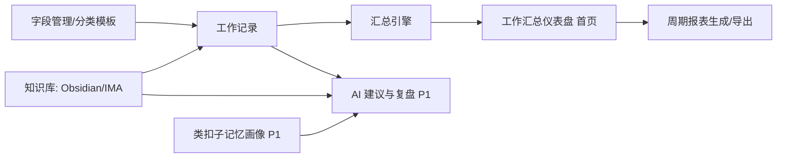
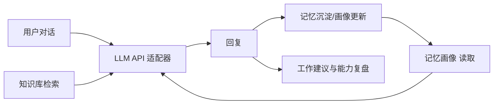

# 一人法务工作平台（OnePerson_LA）精简版产品需求文档（Lean PRD）

## 1. 文档信息

### 1.1 版本历史

| 版本 | 日期 | 作者 | 变更说明 |
| --- | --- | --- | --- |
| v0.1 | 2026-11-09 | PM Agent（BSPM） | 初稿：基于导演指令产出 MVP 规格，含待确认问题清单 |
| v0.2 | 2026-11-09 | PM Agent（BSPM） | 导航重构：工作汇总仪表盘设为首页；工作记录下拉展示两级分类；新建记录改为分组模态弹窗（参考资产新增表单）；导航名称统一四字对齐 |
| v0.3 | 2026-11-09 | PM Agent（BSPM） | 确认待确认问题 7/8：状态与截止日期为全模板默认公共字段；分类固定两级；移除 HTML 原型交付物 |
| v0.4 | 2026-11-13 | PM Agent（BSPM） | MVP 交付后补充：新增 Windows 桌面客户端（Tauri）与桌面便签模块（随手记 + AI 归类 + 设置开关）；记录实现偏差（分类扁平化为一级、PWA 与记忆画像已提前交付）；开源准备 |

### 1.2 文档目的

- 将“一人法务工作平台”的初始想法收敛为**可执行的 MVP 规格**，作为 UI/UX、Web 前端、后端、测试/部署各 AI Agent 的协作基准。
- 明确 P0 范围、业务规则、验收标准、合规基线与发布清单，确保“可部署、可访问、可回滚”。

### 1.3 相关链接或文档引用

| 文档 | 路径 | 状态 |
| --- | --- | --- |
| 路线图 | `Doc/Roadmap.md` | 待产出（MVP 范围确认后） |
| 用户故事地图 | `Doc/User_Story_Map.md` | 待产出 |
| 指标框架 | `Doc/Metrics_Framework.md` | 待产出 |
| API 接口约定（OpenAPI） | `backend/docs/openapi.yaml`（后端 Agent 产出） | 待产出 |

---

## 2. 产品概述

### 2.1 产品名称与定位

- **产品名称**：一人法务工作平台（工程代号 **OnePerson_LA**）。
- **定位**：面向**独立法务/律师个人**的“工作记录 + 报表复盘 + 知识库 + AI 自我对话”一体化 B/S 工作台，终极形态是**“AI 版本的我”**：能基于我的工作记录、专业知识库与思维习惯画像，与我有效对话，帮我看清优势劣势并调整工作方向。

### 2.2 目标用户一句话画像

- **独立执业律师 / 企业唯一法务人员**：日常事务杂、项目多、无团队支撑，需要自己记录、自己复盘、自己迭代能力体系。

### 2.3 价值主张与独特卖点

- **结构化记录**：字段完全自定义、按项目分类差异化，记录即数据资产。
- **自动复盘**：记录一键汇总为日报/周报/季报/年报与可视化复盘，支持定时自动输出。
- **AI 自我**：知识库（专业知识）+ 类扣子记忆模块（思维习惯与喜好）双引擎接入对话与工作建议，越用越懂我。

### 2.4 目标平台与浏览器列表

| 项 | 约定 |
| --- | --- |
| 部署形态 | **桌面 Web 优先**（响应式 SPA）；移动 H5 仅列入 P2 储备 |
| 桌面客户端（v0.4 新增） | **Windows 桌面客户端**：Tauri 2 薄客户端加载远程服务器页面，NSIS 安装包分发；目标 Windows 10/11（WebView2 运行时） |
| 目标浏览器 | Chrome ≥ 110、Edge ≥ 110、Firefox ≥ 115、Safari ≥ 16（最近两个大版本优先保障） |
| 微信内置浏览器 | **不支持**，明确排除（桌面工具属性，不做 H5 分享裂变） |
| 最小适配宽度 | 1280px 为主工作区；768px 以上可用（降级为单栏 + 抽屉导航） |
| 部署地域 | MVP 默认**本地/私有部署**（不公网暴露，无需备案）；公网发布阶段按中国大陆要求完成 ICP/公安备案 + HTTPS |

### 2.5 核心假设与约束（B/S 专项）

- **技术形态**：前后端分离 **SPA + REST API**；登录态工具型产品，**无 SEO 需求**；首期不做 PWA。
- **部署与网络**：MVP 本地部署（localhost / 内网），同源访问无跨域问题；公网版本需域名、HTTPS 证书、CDN（静态资源）、CORS 白名单与 ICP/公安备案（列为 v1.x 风险项）。
- **安全基线**：全站 HTTPS（公网阶段）；XSS 防护（富文本渲染白名单过滤）；CSRF Token（非 GET 请求）；CSP 基础策略；Cookie `SameSite=Lax + HttpOnly` 或内存态令牌。
- **数据敏感性（法务专项）**：工作记录含案件/客户敏感信息 → 提供**敏感字段脱敏开关**；LLM 外发内容默认走脱敏策略或允许配置**本地模型**；API Key 加密存储、不明文落盘。
- **运行与性能**：首屏 FCP ≤ 2s、LCP ≤ 3s（本地网络）；记录列表虚拟滚动；知识库索引增量更新；图表懒加载。
- **第三方依赖清单**：LLM API（多厂商适配器，用户自配 Key）、Obsidian 本地库读取、腾讯 IMA（**开放接口待确认**）、错误监控（自托管或轻量 SDK，披露于设置中心）。

### 2.6 商业模式一句话

- 个人自用工具优先；后续可演进为面向独立法律人的订阅制 SaaS（**非 MVP 目标**）。

### 2.7 代理协作对象与接口摘要

| AI Agent | 主要输入 | 主要输出 |
| --- | --- | --- |
| UI/UX 设计 Agent | 本 PRD、用户故事地图 | `design/prototypes/`、`design/specs/Design_Spec.md` |
| Web 前端开发 Agent | UI 稿、设计规范、OpenAPI 约定 | `web/` 代码库、构建/发布说明 |
| 后端开发 Agent | PRD 数据/鉴权/指标要求 | `backend/` 代码、`openapi.yaml`、部署配置说明 |
| 测试/部署 Agent | PRD 验收标准、发布清单 | 测试报告、发布记录、CI/CD 与回滚预案 |

---

## 3. 使用场景与用户故事

### 3.1 核心场景（≤3）

**场景 1：日常结构化工作记录**

- 用户故事：作为独立法务，我想要**按项目分类、用我自己定义的字段**快速记录每天的工作，以便记录天然结构化、可汇总、可复盘。
- 用户价值：摆脱流水账，记录即数据资产。
- 流程要点与状态：展开左侧导航“工作记录”选择一级/二级分类 → 加载该分类字段模板 → 在**分组模态弹窗**中填写保存（草稿/已提交）→ 列表筛选与编辑 → 可手动关联知识库条目。
- 边界与异常：字段模板变更后历史记录**保留原值不丢数据**；弱网/接口超时给出可重试提示；未登录态跳转登录页。

**场景 2：工作汇总仪表盘与周期报表**

- 用户故事：作为独立法务，我想要**首页直接以仪表盘展示工作汇总**（统计卡、分类工作量、状态分布、趋势图，周期可切换、区间可自定义），并能一键生成日报/周报/季报/年报，以便看清工作量、结构与趋势。
- 用户价值：打开即复盘，复盘从“凭感觉”变为“看数据”。
- 流程要点与状态：进入首页（默认本周）→ 切换周期/自定义区间 → 统计卡与图表联动刷新 → 一键生成周期报表 → 预览（Markdown/页面）→ 导出；P1 支持定时自动输出周报/月报。
- 边界与异常：区间内无数据时展示空态与引导；汇总任务超时异步化并通知；导出失败可重试。

**场景 3：与“AI 版本的我”对话**

- 用户故事：作为独立法务，我想要与一个**接入了我的知识库、又了解我思维习惯**的 AI 对话，以便获得针对我工作的建议、复盘与能力体系梳理。
- 用户价值：从“工具”升级为“分身教练”。
- 流程要点与状态：配置 LLM API → 发起会话 → 检索知识库 + 读取记忆画像 → 生成回复 → 对话沉淀记忆/画像（类扣子模块）→ 结合工作记录产出建议与复盘。
- 边界与异常：LLM 超时/限流/欠费 → 明确报错并支持切换厂商；知识库路径失效 → 降级为无检索对话并提示；记忆画像可查看、可删除。

---

## 4. MVP 范围与功能清单（P0）

### 4.1 功能清单（P0）

| 功能 | 描述 | 业务规则 | 数据项 | 技术依赖 | 验收标准 |
| --- | --- | --- | --- | --- | --- |
| 左侧导航框架 | 全部功能模块置于**左侧边栏**，名称统一**四字对齐**：**工作汇总**（首页仪表盘）、**工作记录**（可下拉展开分类树）、**字段管理**、**知识接入**、**法务对话**、**设置中心** | 导航固定左侧；当前模块高亮；**导航文字字数对齐（均 4 字）**；默认落地页为工作汇总仪表盘；768px 以下折叠为抽屉 | — | 前端路由 | 6 个模块入口可达且文字视觉对齐；刷新后停留在当前模块；首页默认展示仪表盘 |
| 项目分类管理 | **两级分类**（一级 → 二级，如：合同审查 → 销售合同/采购合同）的增删改查与排序；左侧导航“工作记录”**下拉展开分类树**，点击分类即筛选记录列表 | 分类最多两级；字段模板绑定分类；分类删除时其记录**不删除**（需先迁移） | 分类 ID、父分类 ID、名称、排序、创建时间 | 后端 CRUD、树形下拉组件 | 一/二级分类可建/改/排序；导航下拉展示分类树并点击可筛选；删除保护生效 |
| 字段管理 | 自定义字段（文本/多行文本/数字/日期/单选/多选/附件）与**按分类的字段模板**（一/二级分类均可绑定）；模板同时定义弹窗内的**字段分组**（如 基础信息/过程信息/结果信息）；**所有模板自动注入默认公共字段：状态（在办/办结）、截止日期**（不可删除，用于仪表盘逾期判定） | 字段类型不可随意变更（有数据时仅允许改名/改选项追加）；模板变更不影响历史数据；公共字段对全部分类生效 | 字段 ID、名称、类型、必填、选项、所属模板、所属分组、排序、是否公共字段 | 后端 CRUD、表单引擎 | 新建分类模板含 ≥1 分组与 ≥1 字段；公共字段自动存在；记录弹窗按模板分组动态渲染；历史数据不丢失 |
| 工作记录 | 记录的新增/编辑/删除/列表/筛选；**新建/编辑记录采用模态弹窗**（参考“资产新增”表单形态）：表单按分组分区展示、组内**多列网格排布**、必填项红色星号标识、底部“取消/确定”操作条；手动关联知识库条目 | 保存时按模板校验必填；支持草稿态；关联 KB 条目为多对多；分类通过级联选择（一级 → 二级） | 记录 ID、分类（叶子节点）、字段值 JSON、状态、时间戳、KB 关联 | 表单引擎、KB 检索、Modal 弹窗组件 | CRUD 全通；弹窗分组/网格/必填标识符合规范；筛选按分类/时间/关键字；KB 关联可增删 |
| 工作汇总仪表盘（首页） | **首页以仪表盘展示**：① 周期切换（本周/本月/本季度/今年/自定义区间）；② 5 张统计卡（新增工作、办结、在办、逾期、投入工时，带彩色左边框与状态提示语）；③ 分类工作量条形图（含办结进度）；④ 在办状态分布；⑤ 工作量走势（新增/办结双序列）；⑥ 一键生成日报/周报/月报/季报/年报并预览/导出 Markdown | 汇总口径=记录数、字段聚合（数字求和/均值、文本摘录）、状态与逾期判定；报表可保存历史版本；空区间展示空态与引导 | 仪表盘汇总结果、报表 ID、类型、区间、内容快照 | 汇总服务、图表库（ECharts 等）、Markdown 渲染 | 首页默认加载仪表盘；5 种周期切换与自定义区间生效；统计卡与三类图表数据正确、空态友好；5 种报表周期可生成并导出 Markdown 成功 |
| 法务对话 | 多 LLM API 接入（厂商/Key/模型可配）、会话与消息管理 | Key 加密存储；会话可删除；失败可切换模型重试 | 会话 ID、消息、模型配置 | LLM 适配器 | ≥2 厂商可配置并对话成功；报错信息可感知 |
| 知识库接入-Obsidian | 配置本地 Obsidian 库路径，索引 Markdown，支持检索与引用 | 只读接入不修改原库；增量索引 | 连接器配置、索引条目 | 文件读取、全文索引 | 指定路径可索引；关键字检索返回条目并可被记录/对话引用 |
| 登录/退出与设置中心 | 单账号密码登录、退出；设置中心集中管理账号/隐私/权限/数据 | 令牌刷新与吊销；退出清理本地态 | 用户、会话、同意记录 | 鉴权服务 | 登录成功率 ≥98%；退出后受保护页不可访问 |
| 桌面便签随手记（v0.4） | Windows 独立便签窗口（Tauri 薄客户端，360×520、无边框、默认置顶、托盘常驻、开机自启），与主窗口共享登录态；便签支持新增、行内编辑（双击/铅笔图标，回车保存、Esc 取消）、删除，长文本自动换行 | 便签一行一条 ≤500 字；勾选完成时调用 AI 建议分类/标题/截止日期/风险，确认后转为工作记录并归档，可撤销归档（同步删除生成的记录）；**设置中心「便签 AI 归类」开关**关闭后跳过模型、直接人工填写 | 便签 ID、内容、done、categoryId、recordId、doneAt；设置项 stickyAiSuggest | Tauri 2（多窗口 + 远程 URL ACL + 拖拽区）、LLM 适配器、refresh 会话轮询 | 便签窗可拖拽/置顶/收起/隐藏到托盘；登录态自动同步（≤3s）；AI 建议与人工填写两条路径均可用；撤销归档后便签恢复未完成态 |
| Windows 安装包与分发（v0.4） | NSIS 安装包一键安装；后端静态托管 `/downloads/` 供下载；首次启动内嵌配置页填写服务器地址 | 服务器地址保存在本地 `config.json`；主窗口关闭=隐藏到托盘（不退出）；托盘菜单：显示/隐藏便签、切换置顶、打开主窗口、退出 | config.json（server_url、便签位置/尺寸/置顶） | Tauri NSIS 打包、Express 静态托管、开机自启插件 | 首次填地址即进入工作台（一次性成功，不卡「正在连接」）；重装覆盖升级配置保留；关闭主窗口可从托盘唤回 |

### 4.2 次级功能（P1/P2）与未来储备

| 优先级 | 功能 | 说明 |
| --- | --- | --- |
| P1 | 定时自动报表 | 按配置周期（周/月）自动产出周报/月报并站内通知 |
| P1 | 知识库接入-腾讯 IMA | 多接口连接器第二位（**依赖其开放能力，待确认**，备选：导出导入） |
| P1 | 类扣子记忆模块 | 对话中抽取思维习惯/喜好形成个人画像，持续自适应；画像可查看/删除 |
| P1 | AI 工作建议与复盘 | 结合记录 + 知识库 + 画像，产出针对性建议与能力复盘 |
| P1 | 记录↔知识库智能关联 | AI 推荐关联条目，人工确认 |
| P2 | 能力体系可视化 | 能力雷达/成长曲线，支撑“优势劣势”洞察 |
| P2 | 移动 H5 轻记录 | 响应式补全移动端录入体验 |
| P2 | 公网版/多设备同步 | 备案、HTTPS、CDN、多端同步 |

### 4.3 v0.4 实现偏差与补充说明（以实际交付为准）

1. **分类结构扁平化**：实现阶段将原设计的两级分类收敛为**一级分类（全局唯一命名）**，降低维护成本；导航“工作记录”下拉直接列出一级分类。PRD 中“级联选择（一级→二级）”相应失效，字段模板绑定一级分类。
2. **PWA 提前交付**：v0.1 曾约定“首期不做 PWA”，实际已随前端构建产出 manifest + Service Worker（可安装到桌面）。
3. **记忆画像提前交付**：P1 的“类扣子记忆模块”已实现基础版（对话沉淀记忆条目、查看/删除/清空），后续再做语义聚类与画像可视化。
4. **桌面客户端**：原 PRD 未规划桌面端，MVP 后追加 Tauri 薄客户端（见 4.1 v0.4 两行）；其打包流程与已知坑位沉淀于 `docs/桌面版应用打包指南.md`。
5. **便签 AI 归类开关**：新增设置项 `stickyAiSuggest`（默认开启），作为“AI 可进可退”原则在便签场景的落地。

---

## 5. 流程与交互简图

### 5.1 主业务流程

### 5.2 “AI 版本的我”对话闭环

---

## 6. 非功能需求精简

### 6.1 性能目标

- 首屏 FCP ≤ 2s / LCP ≤ 3s（本地网络）；记录列表 1000 条内滚动无卡顿（虚拟滚动）。
- 汇总/报表：1 万条记录内 ≤ 3s，超出转异步任务。
- 知识库索引：首次全量、后续增量；检索响应 ≤ 1s。
- 缓存策略：静态资源长缓存 + 版本号；接口数据短缓存。

### 6.2 安全与隐私

- 认证：Access + Refresh Token；优先 HttpOnly Cookie + SameSite，若用 localStorage 需声明 XSS 风险；服务端可吊销。
- 法务数据专项：**敏感字段脱敏开关**；LLM 外发默认脱敏或可选本地模型；API Key/凭证加密存储。
- 防护：XSS（富文本白名单）、CSRF Token、CSP、全站 HTTPS（公网阶段）。
- 数据留存：本地存储优先；提供数据导出与删除入口（设置中心）。

### 6.3 兼容性与可访问性

- 浏览器矩阵见 2.4；响应式断点 1280 / 768；最小可用宽度 768px。
- 基本可访问性 WCAG A：键盘可达导航、表单标签与错误提示关联、对比度达标。

---

## 7. 数据与埋点

### 7.1 关键事件与字段

| 事件 | 关键字段 | 用途 |
| --- | --- | --- |
| record_create / record_update | 分类 ID、字段数、是否关联 KB | 记录活跃度 |
| report_generate | 报表类型、区间、耗时 | 报表使用率 |
| dashboard_view | 周期类型、停留时长、统计卡点击 | 复盘完成率 |
| kb_index / kb_search | 连接器类型、条目数、命中率 | 知识库价值 |
| chat_send | 模型厂商会话轮次、是否带检索 | 对话活跃度 |
| suggestion_view / suggestion_accept（P1） | 建议 ID、采纳与否 | AI 建议有效性 |

### 7.2 成功指标（KPIs）与北极星指标

- **北极星指标**：**周复盘完成率**（每周至少完成 1 次含 AI 建议的复盘）。
- KPIs：日均记录数 ≥ 3；周报表/复盘生成 ≥ 1 次；KB 检索引用率 ≥ 30%；周对话会话 ≥ 3；建议采纳率（P1）≥ 40%。

### 7.3 指标监测计划

- 前端埋点批量上报（本地部署存本地库）；错误监控接入并采样；**每周一回顾**指标看板。

---

## 8. 发布与版本计划

### 8.1 里程碑与时间线

| 里程碑 | 内容 | 环境 |
| --- | --- | --- |
| M0 | 需求确认、OpenAPI 约定、UI 稿 | dev |
| M1（MVP） | P0 全量：记录/字段/报表复盘/对话/Obsidian/登录设置 | dev → prod（本地） |
| M1.5（已交付） | Windows 桌面客户端（Tauri）+ 桌面便签（随手记/AI 归类/开关/编辑/换行）+ 安装包自托管分发 | dev → prod |
| M2（v1.1） | 定时报表、IMA 连接器、记忆模块增强、AI 建议 | dev → prod |
| M3（v1.2） | 能力体系可视化、H5 轻记录 | dev → prod |

### 8.2 风险与缓解策略

| 风险 | 缓解 |
| --- | --- |
| 腾讯 IMA 无开放 API | 连接器抽象化；备选导出导入方案，P1 内可降级 |
| LLM 成本/限流/厂商变动 | 多厂商适配器 + 一键切换；本地模型选项 |
| 法务敏感数据外泄 | 脱敏开关默认开；本地存储优先；Key 加密 |
| 范围蔓延（AI 自我愿景大） | 严格按 P0/P1/P2 执行，P1 需 M1 验收后启动 |
| 公网发布合规 | MVP 不公网；发布前完成备案/HTTPS/隐私页 |

### 8.3 回滚与灰度策略

- 本地部署以**版本化构建 + 数据库备份**回滚；特性开关控制 P1 新模块；公网阶段采用蓝绿/金丝雀发布。

---

## 9. 发布清单（Release Checklist）

- [ ] 9.1 功能验收通过（含异常与边界：空数据、超时、Key 失效、KB 路径失效）
- [ ] 9.2 目标浏览器抽测（Chrome/Edge/Firefox/Safari）与 768px 降级验证
- [ ] 9.3 埋点、错误监控与日志可用，采样与留存符合规范
- [ ] 9.4 配置准备：环境变量、LLM Key 加密存储、Obsidian 路径、备份策略
- [ ] 9.5 隐私与合规：隐私政策/用户协议页、第三方清单（LLM/监控）披露、脱敏开关可见
- [ ] 9.6 回滚方案与数据备份演练通过
- [ ] （公网阶段追加）域名解析、ICP/公安备案、HTTPS 证书、CORS 与 Cookie 白名单

---

## 10. 代理协作接口与交付物映射

| AI Agent | 输入来源 | 产出路径 |
| --- | --- | --- |
| UI/UX 设计 Agent | PRD、用户故事地图 | `design/prototypes/`、`design/specs/Design_Spec.md` |
| Web 前端开发 Agent | UI 稿、设计规范、OpenAPI | `web/` 代码库、构建/发布说明 |
| 后端开发 Agent | PRD 数据/鉴权/指标要求 | `backend/` 代码、`backend/docs/openapi.yaml`、部署说明 |
| 测试/部署 Agent | PRD 验收标准、发布清单 | 测试报告、发布记录、CI/CD 与回滚预案 |

**接口摘要**：`auth/login`、`auth/logout`、`auth/refresh`、`categories/*`、`fields/*`、`records/*`、`reports/generate`、`dashboard/summary`、`kb/connectors`、`kb/search`、`chat/sessions`、`chat/messages`、`profile/memory`（P1）、`user/consents`、`permissions/list`。

---

## 附录 A：待确认问题（本轮）

1. **部署形态**：MVP 是否确认本地/私有部署（推荐）？是否有公网多设备访问的硬性时间点？
2. **账号规模**：是否仅你单人使用？未来是否可能 2–5 人小团队（影响权限模型复杂度）？
3. **LLM 厂商**：首批接入哪几家（如 DeepSeek/Qwen/OpenAI/Claude）？敏感数据是否要求仅本地模型？
4. **腾讯 IMA 接入方式**：是否有可用开放 API？否则是否接受“导出导入”降级方案？Obsidian 库位于本地磁盘还是同步盘？
5. **定时报表通知渠道**：站内通知是否足够，还是需要邮件/企业微信等？
6. **记忆画像边界**：类扣子模块的记忆数据是否要求全部本地存储、可随时一键清除？
7. ~~**仪表盘口径**~~（已确认）：状态（在办/办结）与截止日期作为**所有分类模板的默认公共字段**自动注入，不可删除。
8. ~~**分类层级确认**~~（已确认后调整）：原确认两级；实现阶段扁平化为一级（见 4.3 第 1 条）。
9. **开源计划**（v0.4 新增）：项目计划在 GitHub 开源，需补齐 README / LICENSE / CONTRIBUTING / CHANGELOG / SECURITY；开源前需脱敏检查（`.env`、演示数据、服务器地址不入库）。
